#  NewsFlow AI - Content Aggregation & Publishing Platform

An end-to-end automated news aggregation, AI-powered translation, and CMS publishing system built with **FastAPI**, **VietAI Seq2Seq Transformers**, **Selenium RPA**, and **React 19**.

---

##  Overview

This platform streamlines and automates the editorial workflow for online publishing:
1. **Scrapes** international articles across multiple top-tier tech and lifestyle news platforms.
2. **Translates** English content to natural Vietnamese using the `VietAI/envit5-translation` neural machine translation model.
3. **Formats & Normalizes** data into structured Markdown, generating SEO-optimized slugs, tags, and category classifications.
4. **Interactive Editor**: Provides a web UI for human-in-the-loop review, category customization, and real-time edits.
5. **Auto-Publishing**: Employs Selenium browser automation to authenticate and publish articles directly to the target CMS.

---

##  Architecture & Pipeline

```mermaid
flowchart LR
    A[News Sources\nTechCrunch, Fintech News, etc.] -->|Scraping| B[Crawler Service\nRequests / BS4 / Selenium]
    B -->|English Content| C[AI Translation Engine\nVietAI Seq2Seq + Chunking]
    C -->|Vietnamese Markdown| D[Data Pipeline & Formatter\nSlug + Tags + Metadata]
    D -->|REST API| E[React 19 Frontend\nReview, Edit & Preview]
    E -->|Publish Trigger| F[Selenium RPA Uploader]
    F -->|Automated Posting| G[Target CMS Portal]
```



---

##  Key Features

- **Multi-Source Scraping**: Handlers tailored for dynamic and static layouts:
  - TechCrunch (*Startup / Technology*)
  - Fintech News (*Blockchain / Crypto / Fintech*)
  - Glossy (*Beauty & Fashion*)
  - Robb Report (*Luxury Lifestyle*)
- **Long-Text AI Translation**:
  - Powered by `VietAI/envit5-translation` (Hugging Face Transformers).
  - Custom token-based text chunker prevents attention context overflows while preserving semantic coherence.
- **Human-in-the-Loop Review**:
  - Real-time article editor to tweak headlines, categories, body paragraphs, and SEO tags before publishing.
- **RPA CMS Integration**:
  - Headless/headed Chrome automation via Selenium.
  - Automated session authentication, form population, slug creation, and submission.
- **Containerized & Production Ready**:
  - Docker & Docker Compose setup with Hugging Face model weight caching.

---

##  Tech Stack

### Backend
- **Framework**: Python 3.10+, [FastAPI](https://fastapi.tiangolo.com/), Uvicorn, Pydantic
- **AI & NLP**: PyTorch, Hugging Face Transformers (`VietAI/envit5-translation`), SentencePiece
- **Web Scraping & RPA**: BeautifulSoup4, Requests, Selenium WebDriver
- **DevOps**: Docker, Docker Compose

### Frontend
- **Framework**: React 19, Vite, Tailwind CSS
- **UI & Components**: Lucide React, Sonner (Toasts), Axios

---

##  Project Structure

```text
App/
├── backend/
│   ├── data/                 # Stored JSON crawl outputs
│   ├── utils/
│   │   ├── handlers.py       # Source-specific crawler handlers & markdown formatter
│   │   ├── translator.py     # VietAI translation pipeline & chunking logic
│   │   └── uploader.py       # Selenium automation for CMS publishing
│   ├── .env.example          # Environment variable template
│   ├── Dockerfile            # Container definition
│   ├── docker-compose.yml    # Docker Compose configuration with model volume cache
│   ├── main.py               # FastAPI application entry point & API endpoints
│   └── requirements.txt      # Python dependencies
├── frontend/
│   ├── src/
│   │   ├── components/       # Reusable UI components
│   │   ├── pages/            # Page views (HomePage, NotFound)
│   │   ├── App.jsx           # Routing & Toast setup
│   │   └── main.jsx          # React app entry point
│   ├── .env.example          # Frontend configuration template
│   ├── package.json          # Node.js dependencies
│   └── vite.config.js        # Vite build config
├── .gitignore                # Global workspace gitignore
└── README.md                 # Project documentation
```

---

##  Environment Configuration

### Backend (`backend/.env`)

Copy `backend/.env.example` to `backend/.env` and update the parameters:

```env
# Target CMS Configuration
CMS_BASE_URL=https://your-cms-domain.com
CMS_ADMIN_EMAIL=your_account@domain.com
CMS_ADMIN_PASSWORD=your_secure_password

# Selenium Options (1 for headless execution, 0 to show browser UI)
SELENIUM_HEADLESS=1

# Server Port
PORT=8080
```

### Frontend (`frontend/.env`)

Copy `frontend/.env.example` to `frontend/.env`:

```env
VITE_BASE_URL=http://localhost:8080
```

---

##  Quick Start Guide

### Option 1: Run with Docker Compose (Recommended)

Ensure you have Docker and Docker Compose installed:

```bash
# Navigate to backend directory
cd backend

# Copy environment variables
cp .env.example .env

# Start container
docker-compose up --build -d
```

### Option 2: Local Development Setup

#### 1. Backend

```bash
cd backend

# Create and activate virtual environment
python -m venv venv
# On Windows:
.\venv\Scripts\activate
# On Linux/macOS:
source venv/bin/activate

# Install dependencies
pip install -r requirements.txt

# Start backend server
python main.py
# Or with uvicorn:
uvicorn main:app --host 0.0.0.0 --port 8080 --reload
```

#### 2. Frontend

```bash
cd frontend

# Install dependencies
npm install

# Start Vite development server
npm run dev
```

Open [http://localhost:5173](http://localhost:5173) in your browser to start using the application.

---

##  API Endpoints Summary

| Method | Endpoint | Description |
| :--- | :--- | :--- |
| `GET` | `/health` | Health check endpoint |
| `GET` | `/platforms` | Retrieve list of supported news sources and categories |
| `POST` | `/crawl` | Trigger crawler and translation for provided article URLs |
| `POST` | `/translate` | On-demand text translation via VietAI Seq2Seq |
| `POST` | `/convert/markdown` | Transform JSON articles into formatted Markdown |
| `POST` | `/articles/update` | Update edited article in the persisted JSON file |
| `POST` | `/upload` | Trigger Selenium publishing automation to target CMS |

---


